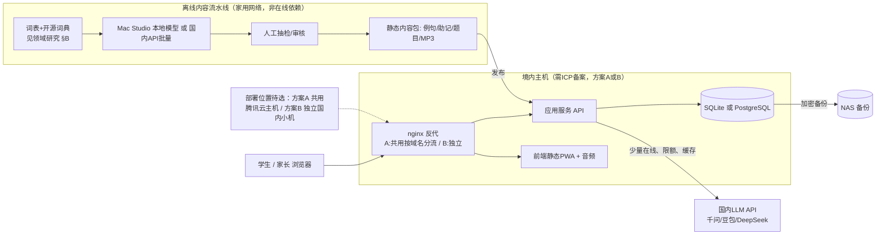

# 初三 AI 背单词 SaaS：技术选型建议（工程负责人）

- **文档时间**：2026-10-17 01:55 上海时间（UTC+8），2026-10-17 02:05 修订（见文末修订记录）｜Owner：工程负责人｜执行位置：共享电脑（box）
- **范围**：只给建议。没有写代码、没有部署、没有注册账号、没有对外发消息，也没有改动任何远端主机。
- **核验口径**：所有链接都在 **2026-10-17** 打开或检索。价格注明区域和币种，按“原价，不含限时优惠”记录。每条标【事实】【推断】【建议】【待实测】，查不到的写「未查到」。
- **上游输入**：《运维巡检.md》（2026-10-17 01:46，数据来自 2026-08-16 的 wiki 记录，当前未实测）和《领域研究.md》（2026-10-17 01:50），两份都在 `/workspace/vocab-saas/research/`。

## 1. 结论摘要
1. 【建议】主站必须放在**境内**，上线前要办 ICP 备案（依据：运维巡检.md §2-2、§3）。腾讯云国内主机是唯一现成的国内入口，但**它的容量待实测**（8 月记录：已跑论文 SaaS 的 4 个容器，约 3.3 GB 内存，无 Swap）。部署位置**待用户选方案 A 或 B**（见 §3.6）：A 是先实测，余量够就共用主机，首期用 SQLite；B 是单独开一台国内小主机。美国 VPS 不做主站：只有 1 GB 内存，443 已经给代理用了，而且被墙过（运维巡检.md §2-1）。
2. 【建议】技术栈从轻：前端 Vue 3 或 React 做 PWA（移动端网页优先）。后端用一个 Node.js/TypeScript 或 Python 服务。数据库用 PostgreSQL，资源实在紧张就退到 SQLite。复习调度用 **FSRS**，许可证是 MIT（见 §3.3）。
3. 【建议】AI 以**离线预生成为主，在线调用为辅**。例句、助记、选择题、TTS 音频都按词表批量生成，人工抽检后作为静态内容提供。在线只保留错因讲解这类个性化调用，走国内 API，带缓存，设每日限额。Mac Studio 只跑离线批量任务，不做在线依赖（运维巡检.md §2-3）。
4. 【推断】按 §5 的假设（缓存命中按 0% 算，全部折成人民币，汇率 1 USD = 6.7220 CNY），1000 名活跃学生每月的在线 LLM 费用：**qwen-flash ≈ ¥315，doubao-seed-2.0-mini ≈ ¥420，DeepSeek flash ≈ ¥1,028–2,057（三家里最贵）**。整套 1600 词的预生成是一次性花费，约 ¥1.5–15（qwen-flash，1 到 10 轮），加上 TTS 约 ¥24。服务器费用待用户选方案 A 或 B。
5. 【建议】数据模型一开始就设计“家长视图”（周报、打卡、用时）。领域研究认为竞品的家长端普遍偏弱（领域研究.md §A 启示 3）。口语评测放到第二期。

## 2. 推荐架构

- 【推断】美国 VPS 在这套架构里没有角色。最多拿来做境外开发测试，且不能接触真实学生数据。

## 3. 各层选型、备选与理由

### 3.1 前端
| 选项 | 结论 | 理由 |
|---|---|---|
| Vue 3 + Vite，做成 PWA | 【建议】首选 | 产物是静态文件，直接由 nginx 提供，不额外占服务器内存（候选的腾讯云主机按 8 月记录只有约 3.3 GB 内存且跟其他业务共用，见运维巡检.md §1；当前余量待实测）。PWA 可以缓存音频和词卡，弱网下也能复习。 |
| React + Vite | 备选 | 两者差别不大，看后续开发者习惯 |
| Next.js / Nuxt SSR | 不建议首期使用 | 需要常驻 Node SSR 进程，多占内存；学习类应用也用不上 SEO |
- 版本号和许可证这一期没有逐个核验（未查到），开发前再锁定。

### 3.2 后端
- 【建议】单体服务。可选 **Node.js（TypeScript）**，用 ts-fsrs 跟前端共用调度逻辑；或者 **Python（FastAPI）**，用 py-fsrs，离线脚本也方便写。两者选一个，不拆微服务。
- 【建议】后端负责鉴权、复习记录、调度、家长视图、AI 代理（集中管理 Key、限流和缓存）。浏览器不直接调 AI API，以免泄露 Key。

### 3.3 数据库与间隔重复调度
- 【建议】按部署方案定：**方案 A**（共用腾讯云主机）首期用 SQLite（单文件、单进程，不额外起数据库进程）；**方案 B**（独立小机）可以直接用 PostgreSQL。两种情况下应用层都用 ORM，保证日后可迁移。【待实测】主机内存余量。
- 核心表（【建议】）：`users`（角色：student/parent/admin），`guardian_links`（家长与学生绑定），`words`（词表版本），`word_content`（预生成内容，带模型、版本和审核状态），`cards`（学生×单词的 FSRS 状态），`review_logs`（每次评分，可用来按个人重新拟合 FSRS 参数），`daily_stats`（给家长周报用），`ai_cache`。
- FSRS 开源库：

| 库 | 版本（发布日期） | 许可证全称 | 许可证链接 | 商用 | 署名 | 传染（Share-alike） | 标签 |
|---|---|---|---|---|---|---|---|
| ts-fsrs | v5.4.2（2026-09-01 UTC） https://github.com/open-spaced-repetition/ts-fsrs/releases/tag/v5.4.2 | MIT License | https://github.com/open-spaced-repetition/ts-fsrs/blob/main/LICENSE | 允许 | 须保留版权及许可声明 | 无 | 【事实】 |
| py-fsrs | v6.3.2（2026-08-09 UTC） https://github.com/open-spaced-repetition/py-fsrs/releases/tag/v6.3.2 | MIT License | https://github.com/open-spaced-repetition/py-fsrs/blob/main/LICENSE | 允许 | 须保留版权及许可声明 | 无 | 【事实】 |
- 【事实】Anki 从 23.10 起支持 FSRS，按个人复习记录拟合参数，默认目标保留率 90%（引自领域研究.md，来源 https://faqs.ankiweb.net/what-spaced-repetition-algorithm.html ）。
- 【推断】墨墨官方说它的 MM 算法针对单词做过优化（领域研究.md，https://memodocs.maimemo.com/docs/markji-mmx-vs-anki-fsrs/ ），但 MM 不是开源库。首期用 FSRS 默认参数就够，攒够复习记录后再按个人优化。
- 【建议】在 FSRS 外面加一层“**中考倒计时排期**”：按离考试的天数倒推每日新词量（领域研究.md 启示 2）。2026 年山西中考笔试是 6 月 20–22 日（领域研究.md §B2，来源：晋城市政府公开页）。

### 3.4 鉴权（未成年人与家长）
- 【建议】家长手机号加短信验证码注册，然后由家长创建或绑定学生子账号。学生用“用户名+密码”或家长生成的绑定码登录，不要求学生提供手机号。目的是少收集数据，并留下监护人同意的记录。
- 【待实测】短信服务（腾讯云 SMS 等）的价格和签名模板审核这一期没有查（未查到），而且需要用备案主体去开通。
- 【事实】《个人信息保护法》第二十八条把不满十四周岁未成年人的个人信息列为敏感个人信息；第三十一条规定，处理这类信息要取得父母或其他监护人同意，并制定专门的处理规则。来源：http://www.npc.gov.cn/npc/c2/c30834/202108/t20210820_313088.html （2026-10-17）
- 【推断】初三学生有的不满 14 岁、有的已满。产品上建议**一律按需要监护人同意处理**，不按年龄分流程。

### 3.5 数据与隐私（未成年人）
依据《未成年人网络保护条例》（国务院令第 766 号，2024-01-01 起施行），来源：https://www.gov.cn/zhengce/zhengceku/202310/content_6911289.htm 、http://xzfg.moj.gov.cn/front/law/detail?LawID=1694 （2026-10-17）
- 【事实】第三十二条：不得强制要求同意非必要个人信息的处理，也不能因为对方不同意就拒绝提供基本功能。→【建议】注册只收必要字段，年级和学校设为选填。
- 【事实】第三十四条：要提供便捷的查阅、复制、更正、补充、删除功能。→【建议】家长视图里做数据导出和删除账号。
- 【事实】第三十五条：发生泄露要启动应急预案，向网信等部门报告，并告知受影响的未成年人和监护人。→【建议】写好事件预案，留存审计日志。
- 【事实】第三十六条：员工访问未成年人信息要按最小授权、经审批、记录访问。→【建议】后台做角色权限和访问日志。
- 【建议】学生数据只存在境内主机和 NAS 备份里。发给 AI API 的内容不带姓名和学校（只发单词和作答）。数据不进美国 VPS。
- 【待实测】跨境传输、生成式 AI 服务备案、经营性 ICP 许可证、教育类应用备案（独立验收提到教技函〔2019〕55 号：ICP 备案、等保测评、省级教育备案）是否适用于纯网页 PWA：本文不展开，以领域研究.md 和运维巡检.md 的核对结论为准；需要用户或律师判断。这可能影响上线周期和成本。

### 3.6 部署方案（待用户选 A 或 B；容量待实测）
| | 方案 A：实测后共用腾讯云主机 | 方案 B：独立国内小主机 |
|---|---|---|
| 前提 | 运维只读实测内存、磁盘和负载余量足够（【待实测】，现有数据来自 8 月记录：4 个容器、约 3.3 GB 内存、无 Swap，见运维巡检.md §1） | 用户同意新增一台国内主机 |
| 数据库 | 首期 SQLite，不加 PostgreSQL | PostgreSQL 或 SQLite 都可以 |
| 反代 | 跟论文 SaaS 共用 nginx，按域名分流；新配置先在测试环境验证，保留回滚方案。配置出错会影响论文 SaaS（【推断】） | 独立 nginx，跟论文 SaaS 隔离 |
| 备案 | 沿用现有主体或新域名（领域研究.md 和运维巡检.md 核对后为准） | 新主机同样需要 ICP 备案 |
| 服务器费用 | 未定（取决于实测结果，可能需要扩容） | 未查到（这一期没有查国内小主机价格） |
| 风险 | 资源争抢，故障影响论文 SaaS | 新增费用和备案周期 |
- 【建议】先授权运维做一次只读实测，再选方案。

## 4. AI 调用方案
| 功能 | 方式 | 理由 | 标签 |
|---|---|---|---|
| 例句（初中难度，3 句/词） | 离线预生成 → 抽检 → 静态 | 每个词的内容对所有学生都一样，生成一次就能重复用 | 【建议】 |
| 助记（词根词缀、联想） | 离线预生成 → 抽检 | 同上，还要防“胡编词源”，必须人工审 | 【建议】 |
| 测验题（英选中、中选英、拼写、例句填空） | 规则生成为主（干扰项从同词表里取），LLM 只做补充 | 规则题零成本、结果确定 | 【建议】 |
| 发音 / TTS | 离线批量合成 MP3，静态提供；也可以用开源词典自带的音标 | 音频一次合成，长期复用 | 【建议】 |
| 错因讲解、易混词对比（个性化） | 在线调国内 API；按（词，错误类型）做缓存；每个学生设每日上限 | 只有这部分是真正的个性化内容 | 【建议】 |
| 口语评测（二期） | 第三方语音评测 API | 山西 2028 年口语计分（转载来源，见下） | 【建议】二期 |

- **Mac Studio 本地模型**：【事实】运维巡检.md 记录为 M3 Ultra，在内网，没有公网入口。Studio 只读连接超时，未查到内存和已装模型。【建议】它只当离线批量生成器用；生成质量对比云端 API 的效果【待实测】。
- **山西听说考试**：【事实，转载】2026 年听力改机考，2027 年口语加入但不计分，2028 年听力 15 分、口语 5 分。来源是搜狐转载的忻州市方案 https://www.sohu.com/a/973371432_120161493 。官方文件和适用范围以领域研究.md 核对后结论为准。二期是否做口语评测以此为前提。

### 4.1 国内 LLM API 价格（原价，2026-10-17 查询）
| 厂商/模型 | 区域 | 输入（元或$/百万 tokens） | 输出 | 备注 | 来源 |
|---|---|---|---|---|---|
| 阿里云百炼 qwen-flash | 中国内地（北京） | ¥0.15（≤128K） | ¥1.5 | Batch 半价；开通后 90 天内有 100 万 token 免费额度 | https://help.aliyun.com/zh/model-studio/model-pricing |
| 阿里云百炼 qwen3.7-flash | 中国内地 | ¥0.2（≤32K） | ¥0.8 | 同上 | 同上 |
| 阿里云百炼 qwen-plus | 中国内地 | ¥0.8（≤128K） | ¥2（非思考）/¥8（思考） | — | 同上 |
| 火山方舟 doubao-seed-2.0-mini | cn-beijing | ¥0.2（≤32K） | ¥2.0 | 缓存命中输入 ¥0.04 | https://ark.volcengine.com/region:cn-beijing/docs/model-pricing |
| 火山方舟 doubao-seed-2.1-lite | cn-beijing | ¥0.80 | ¥2.70 | — | 同上 |
| DeepSeek deepseek-flash（V4.1-Flash） | 官方 API（页面未标区域，以美元计价） | 未命中缓存：高峰 $0.3（≈¥2.02）/ 平峰 $0.15（≈¥1.01） | 高峰 $1.2（≈¥8.07）/ 平峰 $0.6（≈¥4.03） | 高峰时段为周一到周五 UTC 01–04、06–10（北京时间 09–12、14–18），其他时间半价 | https://api-docs.deepseek.com/quick_start/pricing |
所有价格都是【事实】，是否有优惠以控制台为准。
- **汇率**：【事实】2026-10-16 人民币汇率中间价 1 美元 = 6.7220 元，来源：国家外汇管理局 https://www.safe.gov.cn/AppStructured/hlw/RMBQuery.do （表中 2026-10-16 美元一栏 672.2/100 美元），另见中新网 https://www.chinanews.com.cn/cj/2026/10-16/10715433.shtml ，核验日期 2026-10-17。本文的美元价格都按这个汇率折算，实际扣费汇率以 DeepSeek 账单为准（【待实测】）。

### 4.2 TTS 与语音评测（二期可选）
| 服务 | 区域 | 价格 | 来源 | 标签 |
|---|---|---|---|---|
| 阿里云百炼 cosyvoice-v3.5-flash | 华北 2（北京） | ¥0.8/万字符 | https://help.aliyun.com/zh/model-studio/cosyvoice-v3-5-flash | 【事实】 |
| 阿里云百炼 cosyvoice-v3.5-plus | 华北 2（北京） | ¥1.5/万字符 | https://help.aliyun.com/zh/model-studio/cosyvoice-v3-5-plus | 【事实】 |
| 阿里云百炼 cosyvoice-v3-plus | 北京 / 新加坡 | ¥2 / ¥1.9082 每万字符 | https://help.aliyun.com/zh/model-studio/cosyvoice-v3-plus | 【事实】 |
| 讯飞 语音评测（流式版，支持英文 read_word/read_sentence 等题型） | 国内站 | 套餐：20 万次/年 ¥1200；100 万次/年 ¥5800；每个应用每天默认 500 次免费 | https://www.xfyun.cn/doc/member/trial.html 、https://www.xfyun.cn/doc/Ise/IseAPI.html | 【事实】 |
| 讯飞 Pronunciation Assessment | 国际站 | $0.003/次（≈¥0.020）；资源包 10 万次 $150（≈¥1,008） | https://global.xfyun.cn/doc/platform/pricing.html | 【事实】 |
| 豆包 / 腾讯云的 TTS 与口语评测 | — | 未查到（本期没有检索） | — | 未查到 |
| Studio 本地开源 TTS | — | 机器没连上，模型和效果都未查到 | — | 【待实测】 |

## 5. 成本估算（每 1000 名活跃学生 / 月）
**假设**（全部是【推断】，需要按实际用量修正）：
- A1 词表按课标约 1600 词（领域研究.md §B2 推断基线）。
- A2 预生成每词：输入约 300 tokens，输出约 600 tokens（3 句例句、助记、2 道题）。允许整体重跑 10 次。
- A3 在线：每个学生每天 20 次个性化调用 × 30 天，每次输入 500、输出 300 tokens，**缓存命中率按 0% 算**（最保守）。合计每月 3 亿输入 tokens、1.8 亿输出 tokens。
- A4 TTS：每词约 190 字符（单词加 3 句例句），1600 词约 30.4 万字符，只合成一次。
- A5 二期口语评测：每个学生每天 10 次 × 30 天，每月 30 万次。

| 项目 | 计算 | 金额 | 标签 |
|---|---|---|---|
| 预生成（一次性），qwen-flash | 0.48M×0.15 + 0.96M×1.5 | ≈¥1.5/次，重跑 10 次 ≈¥15 | 【推断】 |
| 预生成（一次性），DeepSeek 平峰 | (0.48M×0.15 + 0.96M×0.6) 美元 = $0.648 × 6.7220 | ≈¥4.4/次 | 【推断】 |
| 在线 LLM，qwen-flash | 300×0.15 + 180×1.5 | **≈¥315/月** | 【推断】 |
| 在线 LLM，doubao-seed-2.0-mini | 300×0.2 + 180×2.0 | **≈¥420/月** | 【推断】 |
| 在线 LLM，DeepSeek flash | 平峰 (300×0.15 + 180×0.6) 美元 = $153 × 6.7220 ≈ ¥1,028；高峰 $306 × 6.7220 ≈ ¥2,057 | **≈¥1,028–2,057/月**（三家里最贵；学生多在晚间和周末用，以平峰为主） | 【推断】 |
| TTS（一次性），cosyvoice-v3.5-flash | 30.4 万字符 × ¥0.8/万字符 | ≈¥24 | 【推断】 |
| 二期口语评测，讯飞 | 30 万次/月 ≈ 360 万次/年；100 万次套餐折合约 ¥0.0058/次 | ≈¥1740/月（实际套餐和阶梯价要问销售） | 【推断】 |
| 服务器 | 待用户选方案 A 或 B（§3.6） | 未定：A 要看实测结果，可能需要扩容；B 的国内小主机价格未查到。容量待实测 | 【待实测】 |
| 短信验证码、域名、备案 | — | 未查到 | 未查到 |
- 【推断】缓存加上每日限额以后，在线费用可能远低于上表。真实命中率要等上线后实测。

## 6. 风险与未验证项
- 【待实测】腾讯云主机当前的内存、负载和磁盘（运维数据来自 08-16 wiki）；能否跟论文 SaaS 共存；是否要扩容。
- 【待实测】scholarcanvas.cn 的备案主体和用途能否覆盖新站（运维巡检.md §5）。
- 【待实测】Mac Studio：本次 SSH 超时，内存和模型都未查到；本地模型的生成质量。
- 未核验：生成式 AI 备案、经营性 ICP 许可证、教育类备案的适用性，以及山西口语计分的官方依据。这几项以领域研究.md 和运维巡检.md 的结论为准。
- 风险：AI 内容出错（词源乱编、例句超纲）→ 预生成后必须人工抽检，并在页面上标注“AI 生成”。
- 风险：单机部署，宕机就停服 → 首期接受这一点，做好每日备份到 NAS，并演练恢复。
- 未查到：前端框架、PostgreSQL 版本和许可证，短信价格，豆包和腾讯云的语音评测价格。

## 7. 需用户决策项
1. 新站用 scholarcanvas.cn 的子域名，还是另注册新域名（两种都要备案）？
2. 是否收费？这会影响经营性 ICP 许可证的判断。
3. 首选哪家 AI 厂商？按 §5 的假设：千问 qwen-flash ≈ ¥315/月（TTS 和 LLM 在同一平台），豆包 ≈ ¥420/月，DeepSeek ≈ ¥1,028–2,057/月（最贵，且用美元计价）。我的建议是首选千问。
4. 二期是否做口语评测？是否等官方中考文件出来再定？
5. 部署选方案 A（实测后共用腾讯云主机，用 SQLite）还是方案 B（独立国内小主机）？选之前是否授权运维做一次只读实测？
6. 后端选 Node/TS 还是 Python？
7. 教育类备案和经营性许可是否适用？需要用户或律师判断（见领域研究.md、运维巡检.md）。

## 8. 交接
- 目标：初三 AI 背单词 SaaS 的技术选型建议。
- 状态：建议稿已完成，没有任何代码或部署。2026-10-17 01:55 上海时间。
- 位置：`/workspace/vocab-saas/research/工程负责人.md`
- 依赖：运维巡检（主机实测）、领域研究（词表和法规核实）。
- 下一位负责人：独立验收（核查来源和价格），然后由 Grok Bot 汇总。

## 修订记录
- 2026-10-17 01:55 上海时间：初稿。
- 2026-10-17 02:05 上海时间：按独立验收.md 修订。(1) AI 成本全部折成人民币（汇率 6.7220，外汇局 2026-10-16 中间价），DeepSeek 改为约 ¥1,028–2,057/月，是三家里最贵的；修正摘要里美元和人民币混用的问题，重新核算了数字。(2) 主方案改为“待用户选方案 A 或 B”，容量待实测，删掉服务器 ¥0；原文末“补充：容量风险”并入 §3.6。(3) 删掉 Studio 的 SSH 用户名和地址。(4) 山西考试和教育类备案的结论改为以领域研究.md 和运维巡检.md 为准。
