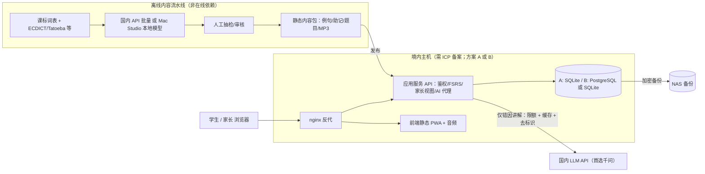

# 初三 AI 背单词网页 SaaS：产品与架构方案 v1（待审阅）

- **编写时间**：2026-10-17 02:12（上海时间，UTC+8）｜汇总：Grok Bot
- **依据**：`/workspace/vocab-saas/research/` 下 5 份文档：领域研究.md（v3，02:00）、工程负责人.md（文中写 02:05 修订，文件实际修改时间 01:58）、内容制作.md（01:50）、运维巡检.md（01:46，补充 01:56）、独立验收.md（含复核第 1 轮）。结论冲突时**以独立验收为准**；山西中考部分以领域研究.md 为准。
- **状态**：本轮只出方案。没有写代码、没有部署、没有注册账号、没有对外联系。开发要等你审阅后再开始。
- **标签**：【事实】有来源且经核对；【推断】由事实推出；【建议】方案选择；【待实测/未验证】证据不足。所有链接都在 2026-10-17 检索。
- **已知未收口**：工程负责人.md 的 L97/L100 仍把山西听说机考的出处写成“搜狐转载的忻州市方案”，L127 把 1600 词的出处写成 §B2（应为 §B1）。独立验收判定这两处不通过，本方案不采用这些写法。

---

## 1. 一页摘要

- **做什么**：一个网页版（PWA，手机优先）英语背单词产品。用 FSRS 安排复习，再加一层“中考倒计时排期”。AI 内容以离线预生成、人工抽检为主，在线只做错因讲解。
- **做给谁**：山西（先以运城为主）的初三学生，以及他们的家长。老师端只预留。
- **差异点**（【建议】，依据领域研究 §A10）：
  1. **中考倒计时排期**：按离考试的天数倒推每天的新词量。【事实】2026 年山西中考笔试在 6 月 20–22 日，英语满分 120 分，其中听力 20 分（晋城市政府转载的省级安排：https://xxgk.jcgov.gov.cn/szfgzbm/jcsjyj/fdzdgknr_31128/ywjyly/zsgl_ywjy/202605/t20260526_2353673.shtml ，经独立验收核对）。
  2. **家长端**：竞品的家长端普遍偏弱（【推断】，竞品资料多为第三方来源）。做周报、打卡情况、用时控制。
  3. **合规、不焦虑的激励**：不排名，不抽卡，有防沉迷。
  4. **AI 用在省钱又可控的地方**：只做例句、助记和错因讲解。释义不交给 AI 生成。
- **核心建议**：AI 首选千问 qwen-flash，在线费用约 ¥315/月（1000 名活跃学生，保守假设）。部署先做一次只读实测，再在方案 A 和方案 B 之间选。上线前必须办 ICP 备案，并按未成年人保护规定设计。

## 2. 产品设计

### 2.1 用户画像（来自内容制作.md，全部是【设计假设】，需访谈或试用验证）
| 编号 | 画像 | 核心需求 |
|---|---|---|
| S1 | 基础薄弱、想补救的学生，常和家长共用设备 | 每天任务少而稳、能完成，不被打击 |
| S2 | 中等水平的学生，拼写不稳 | 跟着教材进度推进，弄清易错拼写 |
| S3 | 冲高分的尖子生 | 查漏补缺，练词形变化，效率高 |
| S4 | 住校、只有周末能用设备的学生 | 周末集中复习，平时有离线或可打印的材料 |
| P1 | 忙碌的双职工家长 | 30 秒看懂孩子“学了没有、卡在哪里” |
| P2 | 焦虑型家长 | 能设目标和时长，但产品要引导“看趋势、少比较” |
| T | 老师（次要用户） | 一期不做，只预留 |

### 2.2 一期 MVP 功能清单【建议】
一期范围：**词汇 + 听音辨词 + 拼写**。口语评测放到以后。
1. 家长手机号注册，创建或绑定学生子账号，记录监护人同意。学生不需要手机号。
2. 入门水平小测（约 3 分钟），用来定起点。
3. 今日任务：先复习到期的词，再学新词。新词每天 5/10/15 个三档，由学生自选。
4. 学新词卡片：先回忆，再看答案。显示释义、音标、例句、离线合成的发音，并注明数据来源。
5. 测验题型：英选中、中选英、**听音辨词**、**拼写**、例句填空。以规则出题为主，干扰项从同一词表里取。
6. 错词本，加 AI 错因讲解和易混词对比（在线调用，有缓存，每人每天有上限）。
7. FSRS 复习排期，加中考倒计时排期。
8. 家长端（见 2.5）。
9. 防沉迷：时长上限、夜间禁用、休息提醒（见 2.4）。
10. 数据权利：查阅、导出、更正、删除账号（依据见第 6 节）。
11. AI 内容固定标注“AI 生成，可能有误，仅供参考”，并提供“报告错误”按钮。
12. PWA 离线缓存词卡和音频，弱网下也能复习。另外可生成可打印的“早读单”。

### 2.3 学习流程【建议】
```
水平小测 → 今日任务（复习到期词 → 学新词）→ 测验（选义 / 听音辨词 / 拼写）
→ 答错：立刻给正确答案 + 错因说明 → 进错词本 → FSRS 提前再考
→ 完成页（只说自己的进步）→ 家长周报汇总
```
- 一轮默认不超过 15 分钟。主要使用时段是晚自习后或在家，每次 10–20 分钟；周末 20–30 分钟（【待实测】）。
- 考前约 8 周进入冲刺：每天总量不增加，系统建议新词降为 0，只复习高频易错词。
- 【事实】学习科学依据：间隔练习比集中练习记得更牢（Cepeda 2006，https://pubmed.ncbi.nlm.nih.gov/16719566/ ）；检索练习比反复重读效果好（Roediger & Karpicke 2006，https://pubmed.ncbi.nlm.nih.gov/16507066/ ）。两项均经独立验收核对。【推断】这些研究的被试不是中国初三学生，在本产品上的效果【待实测】。

### 2.4 激励与防沉迷
- 【建议】完成“今日最低任务”（例如复习到期词的 80%）就算打卡。每周有 1 天休息日；断签后 48 小时内补完一轮可以续上。连续天数只给自己看。
- 【建议】奖励只做成就徽章、词汇掌握地图和周回顾。不做随机掉落、宝箱、抽卡，也不卖加速道具。不展示排名，不说“落后××%的人”，不用红叉，不做倒计时恐吓。
- 【事实】网信办《移动互联网未成年人模式建设指南》（https://www.cac.gov.cn/2024-11/15/c_1733364304749288.htm ，独立验收打开原文核对）：不满 16 岁默认每天总时长不超过 1 小时；连续使用 30 分钟提醒休息；22 时至次日 6 时默认不提供服务（家长可豁免）。注意：该指南约束的是移动终端、应用和应用商店的“未成年人模式”。
- 【建议，待你拍板】默认每天总时长上限 30 分钟（比指南的 1 小时更严，这是产品选择），家长可调；22:00–次日 6:00 不能开始新一轮；每学 15 分钟提示护眼休息（指南是 30 分钟提醒）；不推送深夜通知；不做无限刷。
- 防沉迷提示文案里“记忆也需要睡眠”这句没有来源，上线前删掉或补来源。

### 2.5 家长端【建议】
- 周报：学习天数、用时、新学词数、复习正确率及与上周对比、卡得多的题型。语气客观，只陈述数据，例如“建议：多鼓励坚持，不必加量”。
- 家长可设每日时长上限、夜间时段；新词量只能建议，不能强制加码。
- 数据导出、删除账号、查看监护人同意记录。
- 数据模型一开始就有 `guardian_links`（见 4.3）。

## 3. 词表与词典数据（以独立验收 §5 为准）

| 数据 | 结论 | 判定 | 一期用法【建议】 |
|---|---|---|---|
| 2022 版义务教育英语课标词汇表 | 【事实】教育部 2022-04-21 印发（http://www.moe.gov.cn/srcsite/A26/s8001/202204/t20220420_619921.html ）。“共 1600 词（505 + 1095）”只是二手数字（头条转述，正文读不出来）。商用地位涉及《著作权法》第五条 | 出处成立；词数和商用地位**未验证**，需律师确认 | 作为词表基线（【推断】，因为省级和市级文件都没有规定词表）。用之前对照官方 PDF 核对词数 |
| 山西考纲词表 | 省级文件晋教〔2025〕7号、吕梁吕教发〔2025〕22号都**没有词汇要求**；山西考试说明或词表未查到 | 未验证 | 暂不使用 |
| 人教版等教材词表 | 著作权属于出版社 | 判断合理，未验证 | 不复制词表、释义和例句；教材单元映射和“人教版”字样的使用需律师确认 |
| ECDICT | MIT（https://github.com/skywind3000/ECDICT/blob/master/LICENSE ），作者在 issue #43 确认可商用 | **代码和数据库的授权成立**，但 MIT 不保证上游数据干净 | 当释义和音标的主数据源，在“关于”页保留声明。**首期只用音标、释义、词形，不展示柯林斯星级、牛津 3000 标记和 zk/中考标签** |
| Tatoeba 例句 | CC BY 2.0 FR（部分 CC0），https://tatoeba.org/en/terms_of_use | 成立 | 可以用，每句存作者和许可并在界面展示；也可用 AI 生成例句再人工审核 |
| Princeton WordNet | BSD 风格许可，可商用，需保留版权声明，不得用 Princeton 名义宣传（https://wordnet.princeton.edu/license-and-commercial-use ） | 成立 | 可作补充 |
| CMUdict | CMU 的 BSD 风格条款（不一定是标准的 2-clause） | 基本成立，以 LICENSE 原文为准 | 可作发音补充 |
| Wiktionary / Wiktextract | CC BY-SA 4.0 + GFDL，有相同方式共享义务 | 成立 | **首期不用** |
| Open English WordNet | 文档写 CC BY 4.0 | **未验证**（仓库没打开） | 暂不用 |
| AI 生成内容 | 版权和审核责任 | 待律师确认 | 只用于例句和助记，不生成释义或考点结论；上线前人工抽检 |
| FSRS 库 ts-fsrs v5.4.2 / py-fsrs v6.3.2 | MIT | 成立 | 保留版权和许可声明 |

## 4. 技术架构（依据工程负责人.md，并按独立验收的复核意见修正）

### 4.1 架构图


### 4.2 前端与后端【建议】
- 前端：首选 Vue 3 + Vite 做 PWA（React + Vite 备选）。产物是静态文件，由 nginx 直接提供，不额外占内存。首期不用 SSR（Next/Nuxt）。版本号和许可证开发前再锁定（未查到）。
- 后端：单体服务，不拆微服务。二选一：Node.js（TypeScript）+ ts-fsrs，能和前端共用调度逻辑；或 Python（FastAPI）+ py-fsrs，写离线脚本更方便（待你决定）。
- 后端负责鉴权、复习记录、调度、家长视图和 AI 代理。**浏览器不直接调用 AI API**，Key 集中放在服务端，限流和缓存也在服务端做。

### 4.3 数据库【建议】
- 方案 A 首期用 SQLite（不另起数据库进程）；方案 B 可以直接用 PostgreSQL。应用层统一用 ORM，方便以后迁移。
- 核心表：`users`（student/parent/admin）、`guardian_links`、`words`（带词表版本）、`word_content`（带模型、版本和审核状态）、`cards`（每个学生对每个词的 FSRS 状态）、`review_logs`、`daily_stats`、`ai_cache`。

### 4.4 FSRS 复习排期
- 【事实】Anki 从 23.10 起支持 FSRS，按个人记录拟合参数，默认目标保留率 90%（https://docs.ankiweb.net/ ，旧地址 faqs.ankiweb.net 会跳转过去）。
- 【建议】首期用 FSRS 默认参数，攒够 `review_logs` 后再按个人优化；中考前可调高保留率。外层加“中考倒计时排期”，按剩余天数倒推每日新词量。

### 4.5 AI 使用方式【建议】
| 功能 | 方式 |
|---|---|
| 例句（初中难度，每词 3 句）、助记 | 离线预生成 → 人工抽检（重点防止乱编词源、例句超纲）→ 作为静态内容提供 |
| 测验题 | 以规则出题为主，LLM 只做补充 |
| 发音 | 离线批量合成 MP3（阿里云 cosyvoice-v3.5-flash），静态提供 |
| **错因讲解、易混词对比** | **唯一的在线调用**：用国内 API，按（词，错误类型）缓存，每个学生每天有上限；只发单词和作答，不带姓名和学校 |
| 口语评测 | 二期再定（见第 7 节） |
- Mac Studio 只当离线批量生成器，不做在线依赖。它的内存、已装模型和生成质量都【待实测】（本轮连接超时）。

### 4.6 部署：方案 A 与方案 B 并列（待你选）
| | 方案 A：实测后共用腾讯云主机 | 方案 B：单独开一台国内小主机 |
|---|---|---|
| 前提 | 运维只读实测内存、磁盘、负载，余量够才用。现有数据只是 2026-08-16 的 wiki 记录（约 3.3 GB 内存，跑着论文 SaaS 的容器，无 Swap），**不是实测** | 你同意新增一台国内主机 |
| 数据库 | 首期 SQLite | PostgreSQL 或 SQLite |
| 反代 | 和论文 SaaS 共用 nginx，按域名分流；新配置先在测试环境验证，保留回滚方案 | 独立 nginx，和论文 SaaS 隔离 |
| 备案 | 沿用现有主体或用新域名（scholarcanvas.cn 的备案主体和用途能否覆盖新站，未查到） | 同样需要 ICP 备案 |
| 服务器费用 | 未定，看实测结果，可能需要扩容 | 未查到（这一期没查价格） |
| 风险 | 资源争抢，配置出错会影响论文 SaaS（【推断】） | 多一笔费用，备案要时间 |
- 【建议】先批准一次只读实测，再选方案。
- 【事实，资料性】美国 VPS 只有 1 GB 内存，443 已经给代理用，旧 IP 被墙过。**不做主站**，也不接触学生数据。NAS 只做备份目的地。
- 【未验证】运维本轮“端口可建连”的结果可能是 box 出站代理造成的假象，不能当作端口开放的证据。

## 5. 成本（人民币；按工程负责人.md 02:05 修订版，已经独立验收复算）

**估算假设**（全部是【推断】，需按实际用量修正）：
- 汇率：1 美元 = 6.7220 元（【事实】国家外汇管理局 2026-10-16 中间价，https://www.safe.gov.cn/AppStructured/hlw/RMBQuery.do ）。DeepSeek 实际扣费汇率以账单为准。
- 词表约 1600 词（课标二手数字，未验证）。
- 预生成：每词输入约 300 tokens、输出约 600 tokens，允许整体重跑 10 次。
- 在线：1000 名活跃学生 × 每天 20 次 × 30 天 = 每月 60 万次；每次输入 500、输出 300 tokens，即每月 3 亿输入 tokens、1.8 亿输出 tokens。**缓存命中率按 0% 算**（最保守），所有请求都在最低价格档内。
- TTS：每词约 190 字符，一共约 30.4 万字符，只合成一次。
- 二期口语评测：每个学生每天 10 次，每月 30 万次。
- 价格都是官网原价，不含优惠（2026-10-17 查询）。

| 项目 | 金额 |
|---|---|
| 在线 LLM，千问 qwen-flash（输入 ¥0.15 / 输出 ¥1.5 每百万 tokens） | **≈ ¥315/月** |
| 在线 LLM，豆包 doubao-seed-2.0-mini（¥0.2 / ¥2.0） | **≈ ¥420/月** |
| 在线 LLM，DeepSeek flash（以美元计价，分平峰和高峰） | **≈ ¥1,028–2,057/月（三家里最贵）** |
| 预生成（一次性），qwen-flash | 约 ¥1.5/次，重跑 10 次约 ¥15 |
| 预生成（一次性），DeepSeek 平峰 | 约 ¥4.4/次 |
| TTS（一次性），cosyvoice-v3.5-flash ¥0.8/万字符 | 约 ¥24 |
| 二期口语评测，讯飞（按 100 万次/年 ¥5800 的套餐折算） | 约 ¥1,740/月（实际价格要问销售） |
| 服务器 | **未定**：方案 A 看实测，方案 B 的价格未查到 |
| 短信验证码、域名、备案、等保测评 | 未查到 |
- 【推断】加上缓存和每日限额后，实际在线费用可能远低于上表，真实命中率要上线后实测。
- 价格来源：阿里云 https://help.aliyun.com/zh/model-studio/model-pricing ；火山方舟 https://ark.volcengine.com/region:cn-beijing/docs/model-pricing ；DeepSeek https://api-docs.deepseek.com/quick_start/pricing ；讯飞 https://www.xfyun.cn/doc/member/trial.html 。

## 6. 合规

### 6.1 ICP 备案与经营许可
- 【事实/资料性】境内服务器对外提供网站服务前要先办 ICP 备案（运维巡检.md；腾讯云说明页 https://cloud.tencent.com/document/product/243 是 JS 渲染页，没读到正文，**未验证**）。
- 【未验证】如果收费，可能需要经营性 ICP 许可证（增值电信业务）。这取决于你是否收费，需律师确认。

### 6.2 教育 App 备案
- 【事实】教技函〔2019〕55号（http://www.moe.gov.cn/srcsite/A16/moe_784/201908/t20190829_396505.html ，独立验收已核对原文）：
  - 第（四）条：先取得 ICP 备案（经营电信业务的还要许可证），再取得等保定级备案证明和等级测评报告，然后向省级教育行政部门做教育业务备案。
  - 第（五）条：以未成年人为主要用户的，应当限制使用时长。
  - 第（六）条：收集未成年人信息要取得监护人同意。
  - 第（十）条：中小学学习类应用实行“双审核”，未经学校集体决策选用的，不得要求学生使用。
  - 第（十一）条：学校统一要求使用的应用不得收费，也不得植入广告和游戏。
- 【推断】文件的适用对象写的是“互联网移动应用”，**纯网页版要不要做教育备案，原文没说，未验证**，需律师或你确认。不过 ICP 备案、未成年人保护和时长限制的义务不受这一点影响。以后如果做小程序或 App，就要备案。
- 【未验证】《教育移动互联网应用程序备案管理办法》（教技厅〔2019〕3号）全文没打开；“教技〔2019〕5号”未查到。

### 6.3 未成年人保护与个人信息
- 【事实】《个人信息保护法》第 28 条：不满 14 周岁未成年人的个人信息属于敏感个人信息。第 31 条：处理这类信息要取得监护人同意，并制定专门规则。第 29 条：敏感信息要“单独同意”（http://www.npc.gov.cn/npc/c2/c30834/202108/t20210820_313088.html ）。
- 【事实】《未成年人保护法》第 74 条第 1 款：不得提供诱导沉迷的产品和服务。第 3 款：**在线教育产品不得插入游戏链接，不得推送与教学无关的广告**。第 2 款的时间、权限、消费管理义务点名的是游戏、直播、音视频、社交类服务（http://www.npc.gov.cn/npc/c2/c30834/202010/t20201017_308279.html ）。
- 【事实】《未成年人网络保护条例》（国务院令第 766 号，https://www.gov.cn/zhengce/zhengceku/202310/content_6911289.htm ）：
  - 第 32 条：不得强制要求同意非必要信息的处理。
  - 第 34 条：要提供查阅、复制、更正、删除功能。
  - 第 35 条：发生泄露要有应急预案，并报告和告知。
  - 第 36 条：员工访问要最小授权、经审批、留记录。
- 【事实】《儿童个人信息网络保护规定》：不满 14 周岁的，收集信息要征得监护人同意（https://www.cac.gov.cn/2019-08/23/c_1124913903.htm ）。
- 【建议】对应的产品设计：
  - 所有学生一律走监护人同意流程（初三学生有的未满 14 岁），同意单独勾选并留存记录。
  - 只收必要字段，年级和学校选填，不收真实姓名和照片。
  - 做数据导出和删除；后台做角色权限和访问日志；写好泄露应急预案。
  - 数据只存在境内主机和 NAS，不进美国 VPS。
  - 不放广告，不放游戏链接。

### 6.4 生成式 AI
- 【未验证】面向公众提供 AI 生成功能，可能涉及《生成式人工智能服务管理暂行办法》的备案或安全评估。几份文档都没有打开原文，需要核实。
- 【建议】降低风险的做法：AI 内容以离线生成、人工审核后的静态内容为主；在线只做错因讲解，调用已合规上线的国内大模型 API；界面标注“AI 生成，可能有误”，并提供报错入口。备案义务最终要律师确认。

## 7. 分期路线图【建议】
| 阶段 | 内容 | 前置条件 |
|---|---|---|
| 0. 准备 | 只读实测主机 → 选 A 或 B；定域名，启动 ICP 备案；律师意见（词表、教育备案、收费许可、生成式 AI）；锁定词表并核对官方 PDF；离线生成并抽检 1600 词的内容和音频 | 你对第 9 节的决定 |
| 1. 一期 MVP | 第 2.2 节的功能：词汇 + 听音辨词 + 拼写，FSRS + 倒计时排期，错因讲解，家长端，防沉迷，数据权利 | ICP 备案完成后才能公网上线 |
| 1.5 小范围试用 | 少量学生和家长试用，验证画像、时长、正确率、AI 缓存命中率和实际成本 | 监护人同意流程上线 |
| 2. 二期 | 口语跟读和评测（先拿到运城官方方案再定）；按个人优化 FSRS 参数；老师端 | 运城官方文件；评测服务价格 |
| 后续 | 小程序或 App（那时要做教育 App 备案）、收费模式 | 法务意见 |
- 【推断】如果运城和吕梁一样 2028 年才开始口语计分，现在的初三学生（2027 届）不受影响。运城的实际安排**未查到**。

## 8. 未验证事项清单
1. 腾讯云主机当前的内存、负载和磁盘（现有数据是 2026-08-16 的资料）；“端口可建连”可能是代理造成的假象。
2. Mac Studio 的内存、已装模型、生成质量（本轮连接超时）。
3. scholarcanvas.cn 的备案主体和用途能否覆盖新站。
4. 运城 2026 年及以后英语听力是否机考、口语是否计分、从哪年开始（运城市教育局栏目页打不开，官方文件未查到）。运城英语分值与全省一致只是推断。
5. 吕梁的听说过渡安排（2026 年听说机考 20 分；2027 年加口语但不计分；2028 年起听力 15 分、口语 5 分）来自吕教发〔2025〕22号（中阳县政府转载页 http://www.sxzhongyang.gov.cn/xxgk/zdlygk/shgysyjs/jy/202601/t20260120_2010636.shtml ，已核对），**只作参考，不代表运城**。省级文件晋教〔2025〕7号只鼓励各市逐步实行机考，没有统一年份（https://jyt.shanxi.gov.cn/sjytxxgk/xxgkml/jytwj/202509/t20250929_9969434.html ）。
6. 课标词数 1600/505/1095 还没在官方 PDF 里核对；课标词表的商用地位；山西考纲词表未查到。
7. ECDICT 上游数据（柯林斯、牛津、中考标签）是否干净；Open English WordNet 的许可。
8. 纯网页是否适用教育 App 备案和等保；教技厅〔2019〕3号全文。
9. 经营性 ICP 许可证、生成式 AI 备案的适用性；所有法律结论。
10. 服务器、短信、域名、备案、等保测评的费用；方案 B 主机的价格；豆包和腾讯云的 TTS 与口语评测价格；讯飞“每天 500 次免费”。
11. 竞品价格：除墨墨外大多来自第三方，扇贝和不背单词的价格出自 2024-11 的文章；百词斩的价格说法互相矛盾；上线前需重查。
12. “双减”文件对学习类产品的约束（未查到）。
13. 用户画像、使用时长、学习科学在本产品上的效果（需试用）。
14. 前端框架、PostgreSQL 的版本和许可证（开发前锁定）。

## 9. 需要你决定的事项
1. 是否批准运维对腾讯云主机做一次只读内存实测（free / df / docker stats / ss 这类命令，只看不改）？
2. 部署选方案 A（实测后共用腾讯云主机，首期 SQLite）还是方案 B（单独开一台国内小主机）？
3. 词表版权等法律问题是否找律师？范围包括：课标词表的商用地位、教材单元映射、ECDICT 上游数据、CC BY-SA、AI 内容的责任。
4. 能否从学校或运城市教育局拿到运城的中考改革实施方案或英语听说机考通知（原件或截图都可以）？
5. 网页版是否需要做教育备案（含等保定级测评）？由你或律师确认。
6. 防沉迷的默认值：每天总时长（建议 30 分钟，指南是 1 小时）和夜间禁用时段（建议 22:00–次日 6:00），家长是否可以调整？
7. 首选哪家 AI 厂商？建议千问 qwen-flash（约 ¥315/月），豆包约 ¥420/月，DeepSeek 约 ¥1,028–2,057/月。
8. 新站用 scholarcanvas.cn 的子域名，还是另注册新域名？两种都要备案；还需要你确认现有备案主体。
9. 是否收费？这会影响经营性 ICP 许可证的判断，也影响能否进学校（55 号文第十一条）。
10. 二期是否做口语评测？是否等运城官方文件出来再定？
11. 后端选 Node.js/TypeScript 还是 Python（FastAPI）？
12. 经营性许可是否适用，是否请律师判断（和第 3、5 项可以一起问）？
